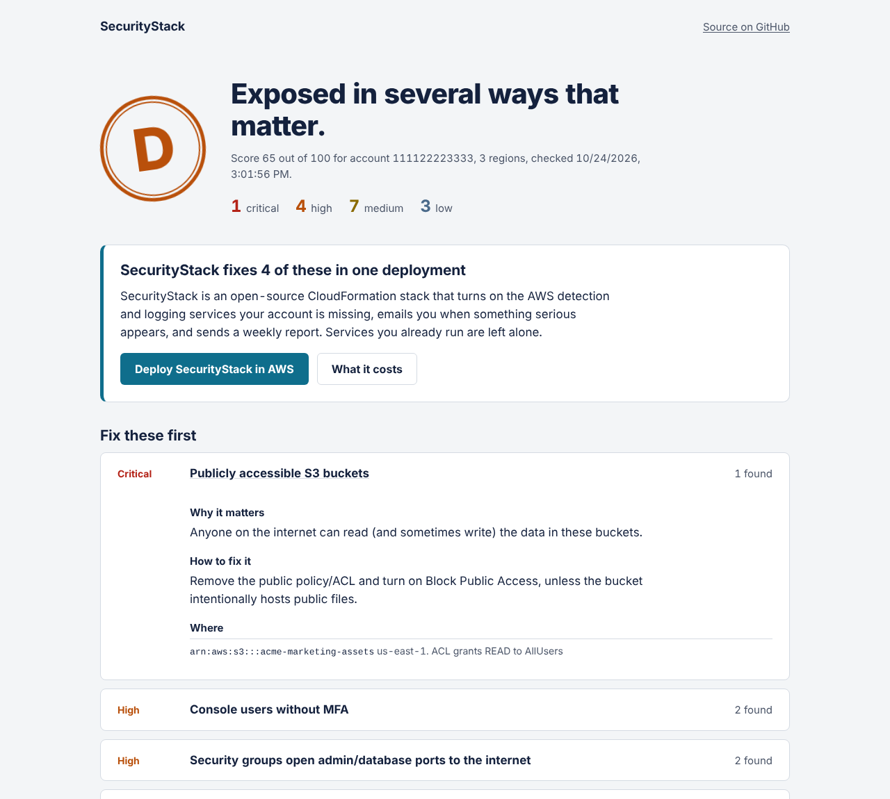
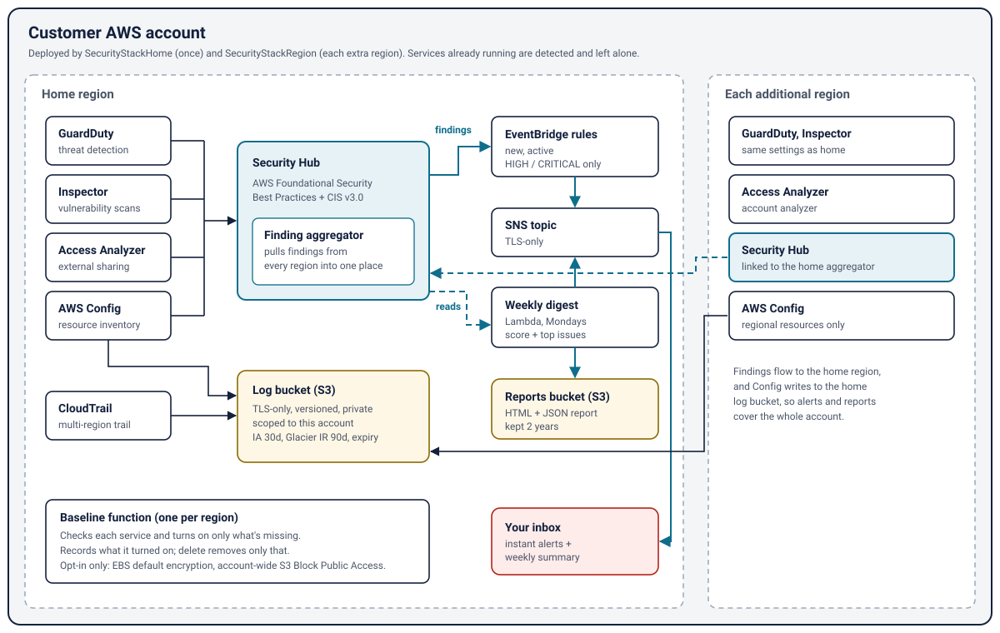
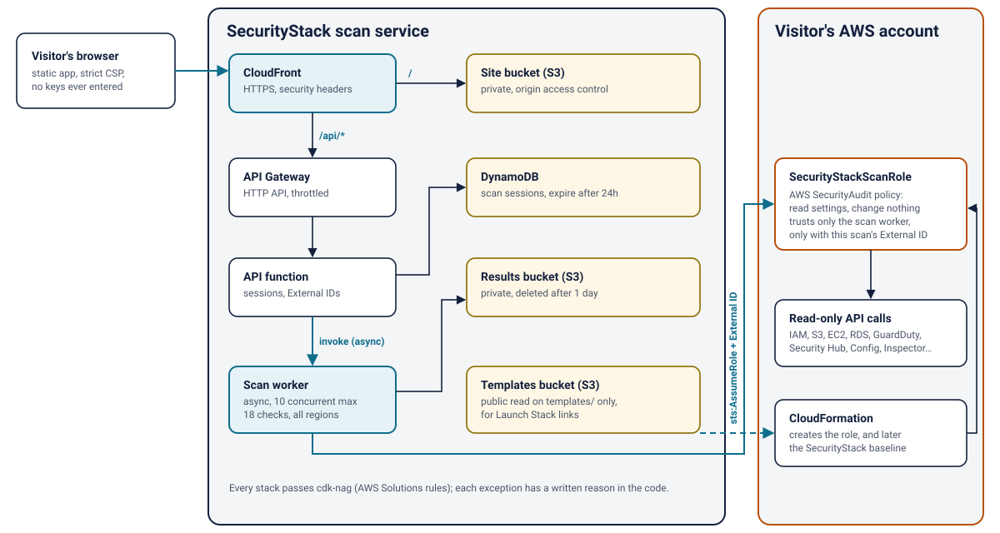

# SecurityStack

**A one-click security baseline for AWS accounts, plus a free read-only scan that shows what's missing first.**

Small companies on AWS usually have no one whose job is security. The services that would catch a leaked key or a public bucket (GuardDuty, Security Hub, Config, Inspector, CloudTrail) are all there, but they're off, and turning them on correctly across regions is a day of work most teams never get to. SecurityStack does it in one deployment. It then sends a plain-English email when something serious happens, plus a weekly report you can hand to an auditor, a customer's security questionnaire, or a cyber insurer.



- **Free scan:** a web app that checks an account for 18 common security gaps in about two minutes, using a read-only role. It never asks for access keys. [How it works](#the-free-scan)
- **Baseline:** CloudFormation templates, built with the AWS CDK in Python, that turn on and wire up AWS's own security services. [What it deploys](#what-the-baseline-deploys)

> SecurityStack supports evidence for SOC 2 and ISO 27001 controls. It does not by itself make you compliant with anything.

## What the baseline deploys



| | What it does | Default |
|---|---|---|
| **GuardDuty** | Detects compromised credentials, crypto-mining, data exfiltration | on |
| **Security Hub** | Continuously checks configuration against the AWS Foundational Security Best Practices and CIS AWS Foundations v3.0 standards | on |
| **AWS Config** | Records resource configuration history (Security Hub's checks depend on it); global resources are recorded once, in the home region only | on |
| **Inspector** | Scans EC2, container images and Lambda for known vulnerabilities | on |
| **IAM Access Analyzer** | Flags resources shared outside the account | on |
| **CloudTrail** | Multi-region trail with log-file validation | on |
| **Cross-region aggregation** | Findings from every region land in the home region | on |
| **Alerts** | Email for new, active HIGH/CRITICAL findings | on (with an email) |
| **Weekly report** | Posture score, counts and the top issues to fix, as an email and an HTML report | on |
| EBS encryption by default | Opt-in auto-fix | **off** |
| Account-wide S3 Block Public Access | Opt-in auto-fix; can break buckets that intentionally serve public files | **off** |

Every service is a switch. CloudFormation can't take over a service that's already running, so you turn off anything you already have. The free scan detects those and pre-fills the switches for you.

Logs go to a private, TLS-only, versioned bucket whose policy only accepts writes from this account's CloudTrail and Config. Logs move to cheaper storage tiers after 30 and 90 days.

## The free scan



1. The visitor picks a region and is sent to a pre-filled CloudFormation page that creates **one read-only role**. The role uses AWS's managed `SecurityAudit` policy, so it can read settings but can't change anything or read data inside files or databases.
2. That role trusts **only the scanner's worker role**, and **only with an External ID generated for that one scan**, which prevents [confused-deputy](https://docs.aws.amazon.com/IAM/latest/UserGuide/confused-deputy.html) abuse. Nobody can point the scanner at someone else's account.
3. The worker runs 18 checks across every enabled region: root MFA and keys, console users without MFA, stale keys, password policy, full-admin policies, public buckets, open SSH/RDP/database ports, public or unencrypted databases, EBS default encryption, and whether each baseline service is on. Checks it couldn't run (for example, access denied) are shown as *couldn't check*, never as passed.
4. The results page shows a grade, what to fix first and why, and a **Deploy SecurityStack** link with the right switches already set.

Results are deleted after 24 hours. No keys are ever entered or stored.

## Deploy

**Fastest:** run the free scan and use the Deploy button on your results page. **Other ways** (Launch Stack, CDK CLI, additional regions, removal): [docs/deploying.md](docs/deploying.md).

## What it costs

SecurityStack itself is free and open source. The AWS services it turns on bill your account directly. This is an **estimate** for a small, single-region account (about 200 resources, 5 EC2 instances, 10 Lambda functions), using AWS's published US East prices:

| Service | Pricing basis | Estimate / month |
|---|---|---|
| GuardDuty | $4 per million CloudTrail management events, plus per GB of VPC flow and DNS logs | $3–7 |
| Security Hub | $0.001 per security check | $5–15 |
| AWS Config | $0.003 per configuration item recorded, plus rule evaluations | $3–15 |
| Inspector | $1.258 per EC2 instance, $0.30 per Lambda function | about $9 |
| CloudTrail, S3, Lambda, SNS, EventBridge | first trail's management events are free; the rest are cents | under $1 |
| **Total** | | **about $20–45** |

GuardDuty and Security Hub have 30-day free trials, and Inspector has 15 days, so the first month is cheaper. Each extra region with little activity adds a few dollars. Check your own numbers with the [AWS Pricing Calculator](https://calculator.aws/).

## Engineering notes

- **CDK as the source of truth.** Reusable `RegionalBaseline` and `HomeBaseline` constructs are composed into two stacks. The release build uses the `BootstraplessSynthesizer` and inline Lambda code, so the published templates have **no S3 assets**: a customer can launch them without installing or bootstrapping CDK.
- **Native resources first.** A Lambda custom resource is used only where CloudFormation has no resource type (Inspector, plus the two opt-in fixes). It reports real failures to CloudFormation, and on delete it only undoes what it did.
- **Security checks on the infrastructure itself.** [cdk-nag](https://github.com/cdklabs/cdk-nag) AWS Solutions rules run on every synth, and synth fails on any finding. Every exception has a written reason next to the code.
- **Tests that don't need AWS.** 51 tests, covering template assertions, the Lambdas, the scanner against a simulated insecure account ([moto](https://github.com/getmoto/moto)), and the full scan API flow including abuse cases.
- **The web app has no dependencies.** Plain HTML, CSS and JavaScript under a strict Content-Security-Policy. API data is only ever written with `textContent`, and outgoing links are checked against the AWS console origin.

### What changed from v1

v1 was a hand-written template. It reported success even when services failed to turn on. It also used the wrong Security Hub standard ARNs, so the standards never turned on, and pointed Config at conformance-pack files that were never uploaded. Its "multi-region" setting covered CloudTrail only. It read only the first page of results, changed customers' buckets and VPCs without asking, and left resources billing after the stack was deleted. All of that is fixed and covered by tests.

## Develop

```bash
pip install -r requirements-dev.txt
pytest                                 # 51 tests, no AWS access needed
npx cdk synth -c withService=true      # all stacks, with cdk-nag
python3 scripts/build_release.py       # one-click templates into dist/
python3 scripts/dev_server.py          # web app with a fake API at localhost:8000
```

```
securitystack/      CDK app: constructs, stacks, scan-service stack
lambdas/            inline Lambdas for the baseline (settings, weekly digest)
service/            scan service: read-only scanner, API and worker
web/                static web app
templates/          customer-facing templates (scan role)
infra/              operator-only templates (GitHub OIDC deploy role)
docs/               architecture diagrams, deployment guide
```

## Roadmap

- AWS Organizations: delegated admin plus StackSets, to deploy to every account in one go
- PDF report generated server-side, with a control-by-control evidence appendix
- Slack and Microsoft Teams alert targets

## License

[Apache 2.0](LICENSE). Security issues: see [SECURITY.md](SECURITY.md).
